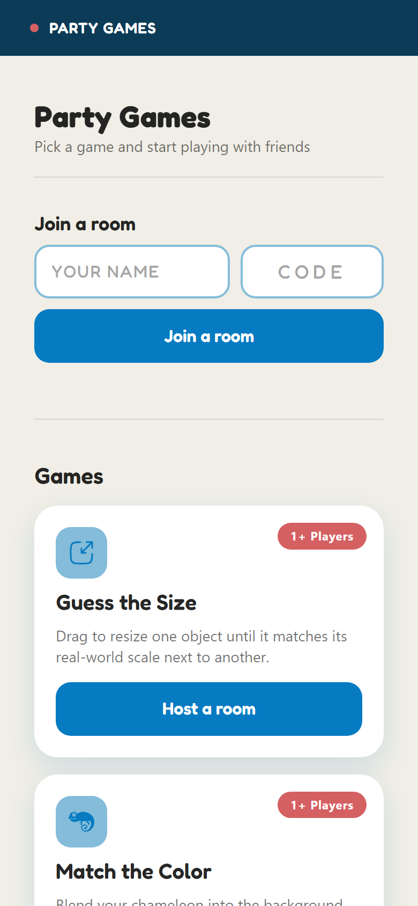
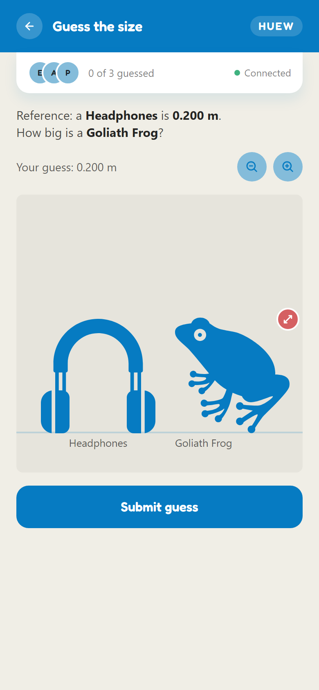
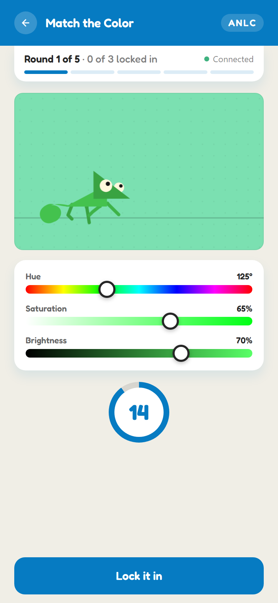
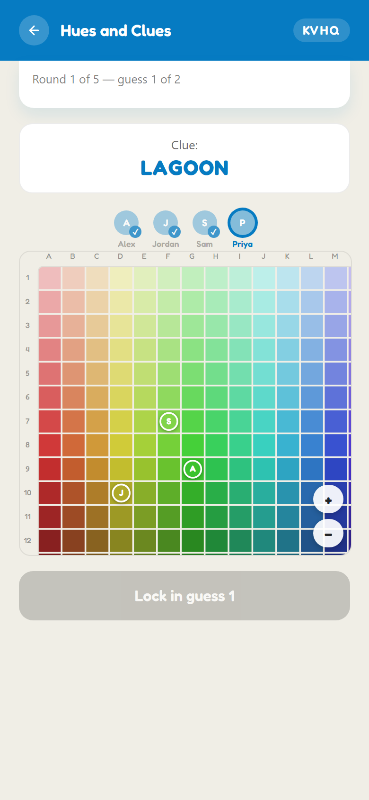
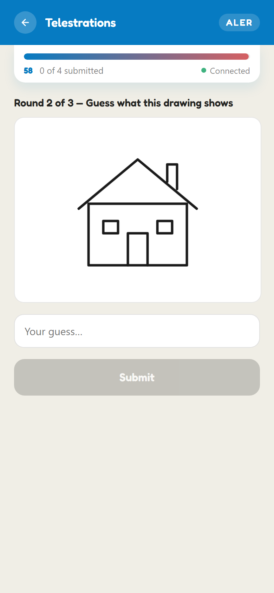
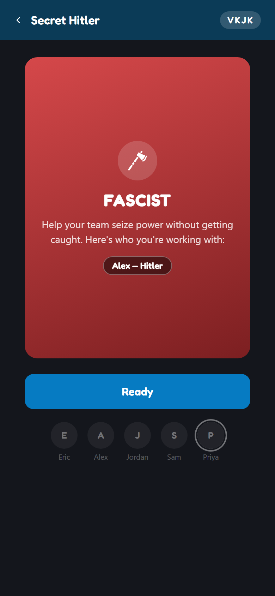
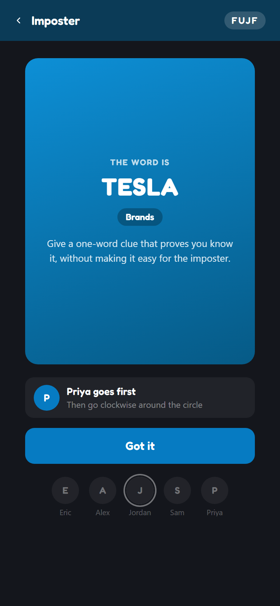

## 🎈 party-games

A little collection of party games to play with friends. One person opens
the lobby on their phone, shares a short room code, and everyone else joins
in from their own phones — no app to download, no accounts to make.

<p>
  
</p>

### The games

<table>
  <tr>
    <td align="center" width="33%">
      <br />
      <b>Guess the Size</b> · 1+ players<br />
      Drag an object until you think it matches its real-world size next to another object. Closest guess wins.
    </td>
    <td align="center" width="33%">
      <br />
      <b>Match the Color</b> · 1+ players<br />
      Blend your chameleon into the background color before time runs out. Closest match wins.
    </td>
    <td align="center" width="33%">
      <br />
      <b>Hues and Clues</b> · 3-8 players<br />
      One player picks a secret color on the grid and gives a one-word clue. Everyone else tries to pinpoint it.
    </td>
  </tr>
  <tr>
    <td align="center" width="33%">
      <br />
      <b>Telestrations</b> · 4-8 players<br />
      Draw a prompt, guess the next player's drawing, and watch the chain drift all the way around the table.
    </td>
    <td align="center" width="33%">
      <br />
      <b>Secret Hitler</b> · 5-10 players<br />
      A hidden-role game of political betrayal. Your phone privately shows your role; the rest happens out loud.
    </td>
    <td align="center" width="33%">
      <br />
      <b>Imposter</b> · 3-12 players<br />
      Everyone gets the same secret word except the imposter. Give one-word clues in person, then vote on who's faking it.
    </td>
  </tr>
</table>

More games get added over time.

### Running it locally

The games run on Cloudflare Workers with Durable Objects (via
[PartyServer](https://www.npmjs.com/package/partyserver)).

```sh
npm install
npm run dev     # local server at http://localhost:8787
npm run deploy  # deploy to Cloudflare
```

To try it from phones on the same Wi-Fi, run `npm run dev -- --ip 0.0.0.0`
and open `http://<your-computer's-local-ip>:8787` on each phone.
